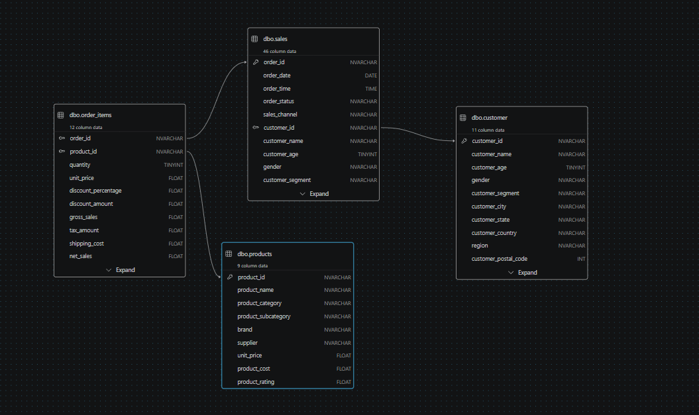
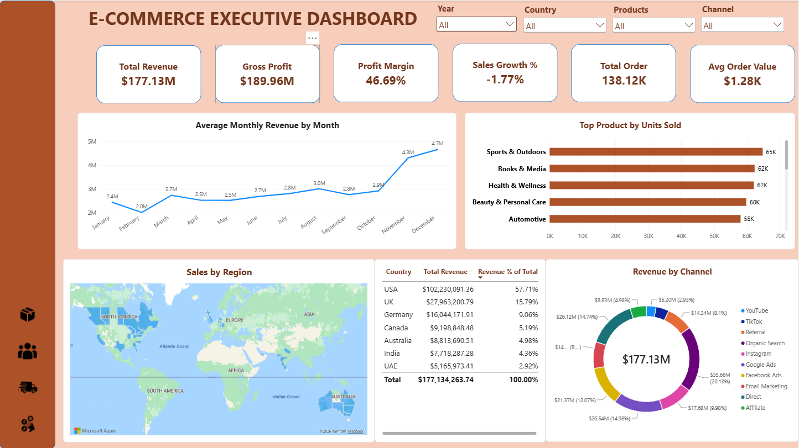
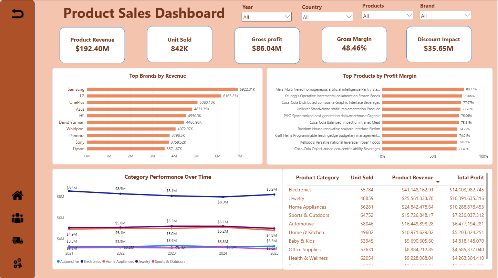
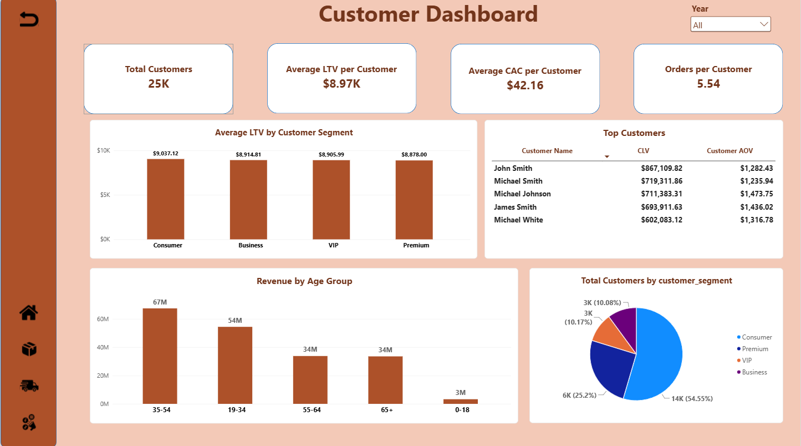
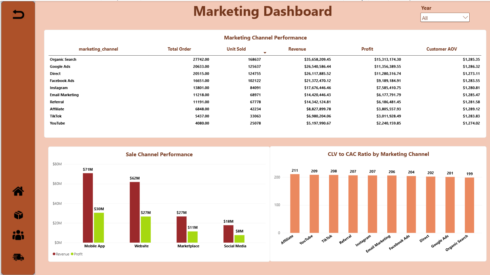
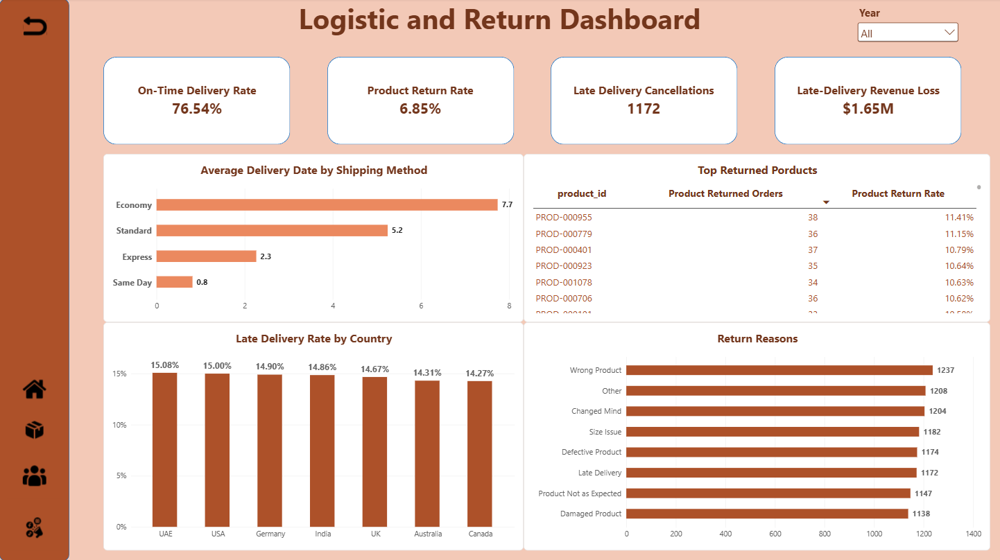

# E-Commerce Sales Analytics
## Project Overview
This project analyzes e-commerce sales data from 2021 to 2025, focusing on data quality validation, customer behavior, sales performance, product profitability, marketing effectiveness, shipping operations, and geographic trends. The goal is to transform raw transactional data into actionable business insights using Microsoft Azure SQL Database, SQL, and Power BI.
## Dataset Overview

The dataset contains approximately **561,860 records** across four main tables, covering e-commerce transactions from **2021 to 2025** across seven countries.

The dataset used in this project was obtained from Kaggle:
[E-Commerce Sales and Customer Analytics Dataset](https://www.kaggle.com/datasets/datascikhan/e-commerce-sales-and-customer-analytics)
| Table | Records | Description |
|---|---:|---|
| `customer` | 25,000 | Customer demographics, segmentation, and acquisition costs |
| `sales` | 138,116 | Order transactions, revenue, profit, and shipping information |
| `order_items` | 397,569 | Product-level sales, quantities, and discounts |
| `products` | 1,175 | Product details, categories, brands, and ratings |
## Database Schema

## Key Business Insights
The project aimed to evaluate e-commerce business performance from 2021 to 2025, examining sales trends, customer behavior, product profitability, marketing effectiveness, and logistics operations. Sales show consistent seasonal patterns, with significant peaks in November and December, while monthly gross sales generally remain between $2 million and $3 million outside peak periods.

Customer and geographic analysis revealed that the USA, UK, and Germany contribute 91.85% of total revenue, while customers aged 19–54 account for approximately 62%. Electronics leads product revenue, generating $39.58 million, although product categories show inconsistent year-over-year growth.

Discount analysis showed that higher discounts are associated with larger purchases but lower profit margins, highlighting the trade-off between sales volume and profitability. Meanwhile, logistics analysis identified 1,172 orders returned due to late delivery, representing approximately $1.62 million in affected revenue.

Overall, the analysis provides data-driven insights to support better marketing decisions, inventory planning, profitability, and operational efficiency.
## Data Visualization
Developed five interactive Power BI dashboards covering:
- Executive Sales
- Product
- Customer
- Logistic and Return
- Marketing

Power BI Dashboard Images

#### 1. Executive Sales Overview

#### 2. Product Performance

#### 3. Customer Intelligence

#### 4. Marketing Performance

#### 5. Logistics & Returns

## Data Quality & Limitations
The analysis identified approximately 11,226 orders with quantity and revenue discrepancies between the Sales and Order Items tables, with a combined revenue difference of approximately $15.26 million.

Approaches to Minimize the Impact of Discrepancies::
- Order-level financial performance is primarily analyzed using the Sales table.
- Product-level performance is analyzed using the Order Items table.
## Conclusion
This project provides data-driven insights into e-commerce sales performance, customer behavior, product profitability, and operational efficiency. The findings highlight opportunities to improve marketing strategies, optimize inventory management, reduce delivery delays, and increase overall profitability.

Beyond descriptive analytics, this project also establishes a foundation for predictive modeling. The insights and identified patterns can support the development of machine learning models to forecast sales demand, predict customer purchasing behavior and identify products at risk of returns. 

By combining SQL analysis with Power BI visualization, this project demonstrates how historical business data can support data-driven decision-making while laying the foundation for the next step: predictive analytics and machine learning models.
